---

## 🕹️ DACHSHUND SNAKE
### *The whole internet controls one sausage dog. You are the next move.*

<table>
<tr><td></td><td align="center"></td><td></td></tr>
<tr><td align="center"></td><td align="center"></td><td align="center"></td></tr>
<tr><td></td><td align="center"></td><td></td></tr>
</table>

🟢 **Game #1 is live** — the doggo is heading **up**. Score: **0** 🦴 · 1 player this round. 
🏆 All-time high score: **0** — the bar is on the floor. Step over it. 
🎮 **1** moves played by **1** players across **1** games

<table align="center">
<tr><th>🏅 HALL OF FAME</th><th>📜 RECENT MOVES</th></tr>
<tr><td valign="top">

| # | Player | Bones | Moves | Deaths |
|:-:|:--|:-:|:-:|:-:|
| 🥇 | [@linusnyren](https://github.com/linusnyren) | 0 🦴 | 1 | 0 💀 |

</td><td valign="top">

| Move | Player | Result |
|:-:|:--|:-:|
| ⬆️ `up` | [@linusnyren](https://github.com/linusnyren) | ✓ |

</td></tr>
</table>

<b>❓ How does this even work?</b>

 

1. Clicking an arrow opens a pre-filled GitHub issue like `snake|up`.
2. Submitting it triggers a [GitHub Action](.github/workflows/snake.yml) that runs [`game/snake.mjs`](game/snake.mjs).
3. The engine moves the doggo, eats bones 🦴, detects crashes 💀, and re-renders the board as an animated SVG.
4. It commits the new board + this README, comments the result on your issue, and closes it.

No servers. No JavaScript in the browser. Just issues, Actions and an unreasonable amount of SVG.

<b>🔒 ???</b>

 

<code>↑ ↑ ↓ ↓ ← → ← → B A</code>

<a href="https://github.com/linusnyren/linusnyren/issues/new?title=snake%7Ckonami&body=%F0%9F%91%87%20**Just%20click%20%22Create%22%20%2F%20%22Submit%20new%20issue%22%20%E2%80%94%20don't%20change%20anything.**%0A%0AA%20GitHub%20Action%20will%20play%20your%20move%2C%20update%20the%20README%20and%20close%20this%20issue%20within%20~30%20seconds.%20Then%20head%20back%20to%20https%3A%2F%2Fgithub.com%2Flinusnyren%20and%20admire%20your%20work%20%F0%9F%90%B6">▶ ENTER CODE ◀</a>

---

## 🧙 PLAYER 1

## 🐍 BOSS FIGHT: THE CONTRIBUTION GRID

<picture>
  <source media="(prefers-color-scheme: dark)" srcset="https://raw.githubusercontent.com/linusnyren/linusnyren/output/github-snake-dark.svg"/>
  <source media="(prefers-color-scheme: light)" srcset="https://raw.githubusercontent.com/linusnyren/linusnyren/output/github-snake.svg"/>
  
</picture>

✦ THANKS FOR PLAYING ✦ · CONTINUE? 9… 8… 7… · <a href="https://github.com/linusnyren?tab=repositories">▶ LOAD SAVE FILES (repos)</a> ✦

