---

## 🕹️ DACHSHUND SNAKE
### *Every player gets their own neon sausage dog. Live. Right now.*

<b>❓ How does this even work?</b>

 

- Everyone on [the arcade](https://linusnyren.github.io/arcade/) gets **their own dachshund** in a unique colour — steer with arrows / WASD / swipe.
- Eat bones 🦴 to grow. Bonk into a wall, yourself or another dog and you're out — your body turns into bones for everyone else, and you respawn a few seconds later.
- Browsers talk over **MQTT-over-WebSockets**. No backend: the oldest active player's browser is elected host and runs the game loop; if they leave, the next one takes over seamlessly.
- Idle dogs ride 🤖 **autopilot** until their human grabs the leash, and a CPU dog keeps you company when you're alone.
- Spam emotes with <kbd>1</kbd>–<kbd>5</kbd>, climb the hall of fame, and try <kbd>↑</kbd><kbd>↑</kbd><kbd>↓</kbd><kbd>↓</kbd><kbd>←</kbd><kbd>→</kbd><kbd>←</kbd><kbd>→</kbd><kbd>B</kbd><kbd>A</kbd>.

---

## 🧙 PLAYER 1

## 🐍 BOSS FIGHT: THE CONTRIBUTION GRID

<picture>
  <source media="(prefers-color-scheme: dark)" srcset="https://raw.githubusercontent.com/linusnyren/linusnyren/output/github-snake-dark.svg"/>
  <source media="(prefers-color-scheme: light)" srcset="https://raw.githubusercontent.com/linusnyren/linusnyren/output/github-snake.svg"/>
  
</picture>

✦ THANKS FOR PLAYING ✦ · CONTINUE? 9… 8… 7… · <a href="https://github.com/linusnyren?tab=repositories">▶ LOAD SAVE FILES (repos)</a> ✦

